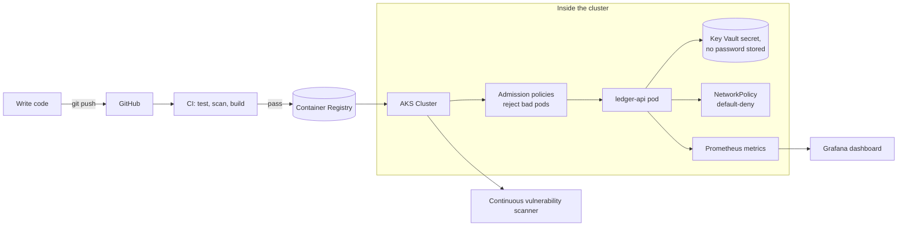

# Session 3 - Building a Secure AKS Platform

## Why this session exists

Every session before this one taught one thing at a time: what a container
is, what Kubernetes is. This session is different on purpose. It takes
everything from Sessions 1 and 2 and asks a harder question: what does it
actually take to run something on Kubernetes **securely**, end to end, in a
real cloud, not just "kubectl apply and hope"?

The answer turned into a real project: `ledger-api`, a small fake banking
API, run on Azure Kubernetes Service (AKS), built and locked down layer by
layer:

1. The container image itself - hardened from the inside out.
2. The cloud infrastructure underneath it - written as code, not clicked
   together in a portal.
3. The Kubernetes deployment - locked down with every security setting
   Kubernetes offers.
4. Admission policies that reject bad workloads before they ever start.
5. Observability - so when something goes wrong, there's a way to see it.
6. A vulnerability management loop - because "secure today" is not the
   same as "secure next month".

Every single piece in this session was actually built, actually deployed to
a real, running AKS cluster, actually tested against real traffic and real
attack attempts - and there's a screenshot or a terminal transcript proving
it, for every step. Nothing here is theoretical.

## Who this is written for

Me, mostly - six months from now, having forgotten half of this. Which
means: assume nothing. If a term shows up, it gets explained the first time
it's used, even if it feels obvious. If something is naive versus
hardened, both get shown side by side with real numbers, not just "trust
me, hardening is good."

## The big picture

Read left to right: code becomes an image, the image gets tested and
scanned before it's trusted, the cluster itself refuses to run anything
that doesn't meet its rules, and once it's running, everything about it is
observable and continuously re-checked for new vulnerabilities.

## How to read this session

Each theory chapter stands alone and builds on the last:

1. [Containers and Images: Naive vs Hardened](theory/01-containers-images.md) -
   what a container actually is, what an image actually is, and why the
   same app built two different ways can have a completely different risk
   profile.
2. [Kubernetes on Azure: AKS and Cilium Networking](theory/02-aks-and-networking.md) -
   what AKS adds on top of plain Kubernetes, and the networking decision
   (Azure CNI Overlay with Cilium) that everything else in this session
   depends on.
3. [Infrastructure as Code with Terraform](theory/03-terraform-iac.md) -
   why the cloud infrastructure itself is written as code, and what that
   code actually says.
4. [Identity and Secrets: Workload Identity](theory/04-identity-and-secrets.md) -
   how the app gets its password without a password ever existing anywhere
   that could leak.
5. [Zero-Trust Networking: NetworkPolicy](theory/05-zero-trust-networking.md) -
   locking down which pods can talk to which, by default nobody.
6. [Admission Control: Kyverno](theory/06-admission-control.md) -
   teaching the cluster itself to say no to bad deployments.
7. [Observability: Metrics, Logs, Alerts](theory/07-observability.md) -
   seeing what's actually happening once it's running.
8. [Vulnerability Management](theory/08-vulnerability-management.md) -
   why a clean scan today doesn't mean clean forever, and what to do about
   that.

Then [The Build Log](journal/the-build-log.md) is the actual journal: the
real commands, the real errors hit along the way, the real fixes, and a
screenshot for almost every step. The theory chapters explain the "why";
the build log is the "and here's exactly what happened when I did it."

The full source code for everything in this session is public:
<https://github.com/adam-bouafia/aks-platform-lab>
