# The Build Log

This is the actual journal - what was run, in order, what broke, what the
real output looked like, and a screenshot for nearly every step. The
theory chapters explain *why* each piece exists; this is *what actually
happened* building it. Read it alongside the theory chapters, or read it
on its own as the story of the whole build.

## Phase 1 & 2: the app and the CI pipeline

Before any cloud infrastructure existed, there was just a small Go HTTP
service (`ledger-api`) with a handful of endpoints (`/healthz`,
`/readyz`, `/api/v1/transactions`, `/metrics`), built two ways exactly as
described in
[Containers and Images: Naive vs Hardened](../theory/01-containers-images.md).

Once the app and both Dockerfiles existed, the CI pipeline was built
around one non-negotiable rule: **a pull request that would ship a
vulnerable image must never be mergeable.** Writing that rule into a
workflow file is easy. Trusting that it actually works requires breaking
it on purpose and watching it hold.

### Breaking the pipeline on purpose

A branch was created that swapped the hardened final stage back out for
an unhardened, full base image, and opened as a pull request titled
plainly: *"drill: break-it test (do not merge)."*

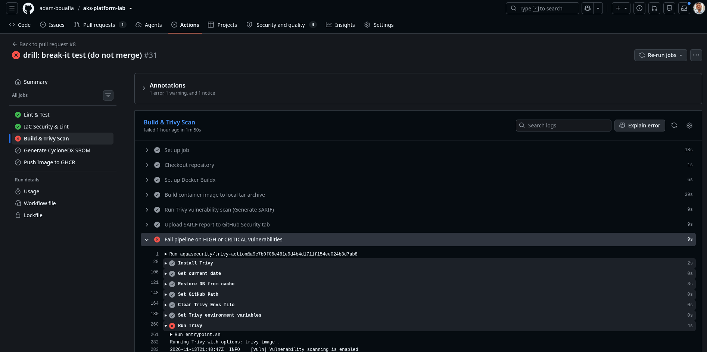

The job summary shows exactly where the pipeline stopped - lint and the
infrastructure scan passed, and the build-and-scan job failed outright,
with everything downstream of it (the SBOM generation, the push to the
registry) correctly never running at all:

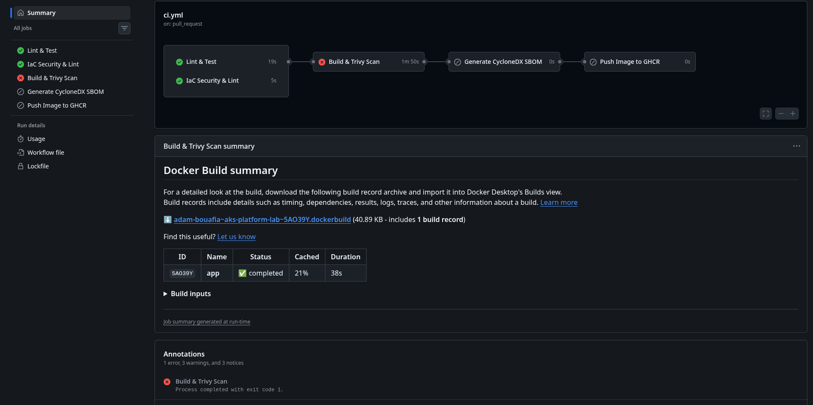

And the part that actually matters - not "a job failed" but "a human
could not override it and merge anyway":

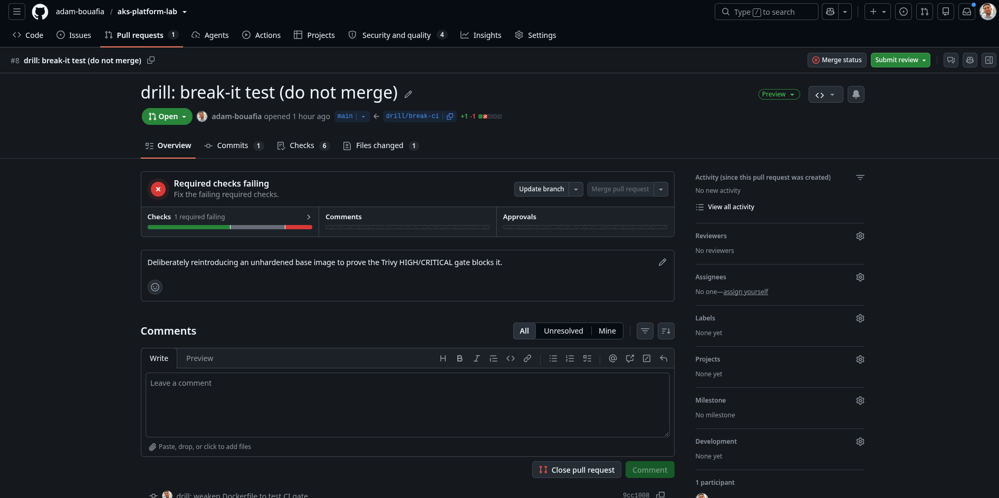

Branch protection on `main` requires every CI job to pass, with no
exception for the repository's own admin account. The severity gate isn't
a suggestion a reviewer could choose to ignore - it's a hard stop, for
everyone, every time.

## Phase 3: building the Azure foundation

With the image proven, the next step was the Azure infrastructure itself,
covered conceptually in
[Infrastructure as Code with Terraform](../theory/03-terraform-iac.md).
The real sequence looked like this.

### Provider registration, hit one error at a time

Exactly as described in the Terraform chapter, a freshly-used Azure
subscription came back with `MissingSubscriptionRegistration` errors,
one Azure resource provider namespace at a time, across the whole build:
`Microsoft.Compute`, then `Microsoft.ContainerService`, then
`Microsoft.Network`, then `Microsoft.ContainerRegistry`, then later
`Microsoft.KeyVault`, `Microsoft.OperationalInsights`,
`Microsoft.OperationsManagement`, and even `microsoft.insights` (hit a
second time, specifically triggered by enabling Container Insights
monitoring). Each one was the same fix, repeated:

```bash
az provider register --namespace <Namespace>
az provider show -n <Namespace> --query registrationState -o tsv   # poll until "Registered"
```

### The first successful cluster

```bash
az aks show -g rg-ledger-lab -n aks-ledger-lab -o table
```

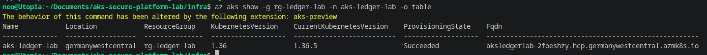

```bash
terraform state list
```

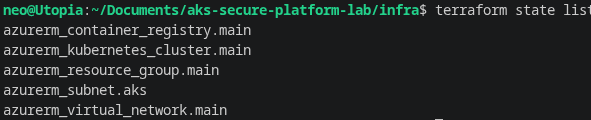

```bash
kubectl get nodes
```

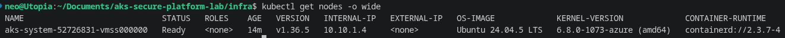

```bash
kubectl cluster-info
```

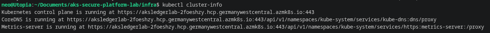

AKS creates its own, separate Azure resource group to hold the actual
VM scale set, load balancer, network security group and node-pool managed
identity behind the cluster - visible directly in the Azure Portal:

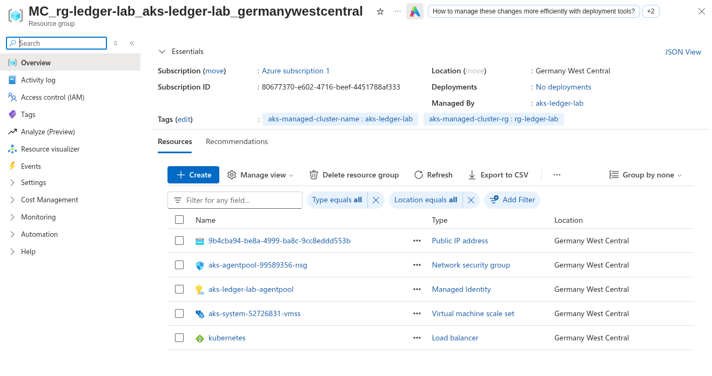

### Growing the infrastructure: identity, secrets, logging

The foundation above was just the cluster shell. Key Vault, the
user-assigned identity with its federated credential, Log Analytics, and
the role assignments connecting them all - everything covered in
[Identity and Secrets](../theory/04-identity-and-secrets.md) - were added
next, bringing the Terraform state to its full, final shape:

```bash
terraform state list
```

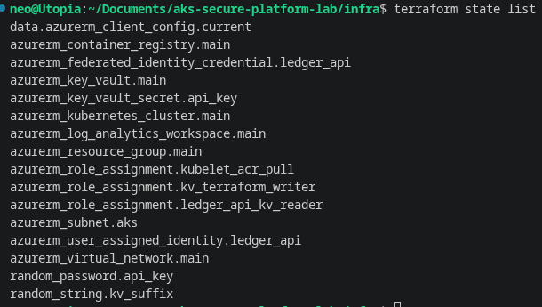

### A real capacity lesson: one small node wasn't enough

Once the app, the observability stack (Prometheus, Grafana), the
guardrails (Kyverno), and the vulnerability scanner (Trivy Operator) were
all deployed, a real problem showed up: the app's pods got stuck
`Pending`, and Grafana itself kept crashing with `OOMKilled`.

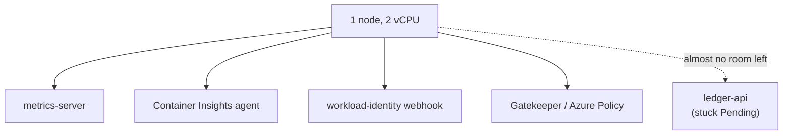

Checking exactly where the CPU was going (`kubectl describe node`, then
summing resource *requests* per pod) showed the node's capacity was
almost entirely consumed by AKS's **own mandatory system pods** -
`metrics-server`, the Container Insights agent, the workload-identity
webhook, Gatekeeper/Azure Policy - before the application was even
deployed. The fix was simple and cheap: scale the node pool from 1 to 2
nodes (an in-place Terraform change, no cluster rebuild needed).

```bash
kubectl get nodes
```

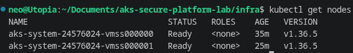

## Phase 4: deploying the app, and proving every security claim live

With the infrastructure settled, the Helm chart from
[Identity and Secrets](../theory/04-identity-and-secrets.md) and
[Zero-Trust Networking](../theory/05-zero-trust-networking.md) was
deployed.

```bash
kubectl apply -f deploy/namespace.yaml
helm upgrade --install ledger-api ./deploy/helm/ledger-api \
  --set workloadIdentityClientId=<...> --set keyVaultName=<...> --set tenantId=<...>
kubectl get pods -n ledger -o wide
```

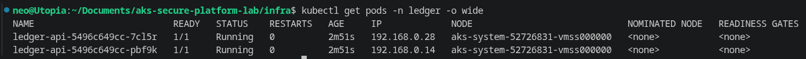

```bash
kubectl get networkpolicy -n ledger
```

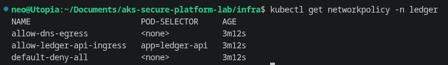

```bash
kubectl get secretproviderclass -n ledger
```

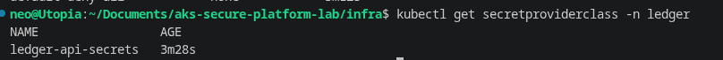

After the node-count fix above, the Deployment's
`topologySpreadConstraints` did exactly what they were written to do -
one replica landed on each node, instead of both piling onto the same
one:

```bash
kubectl get pods -n ledger -o wide
```

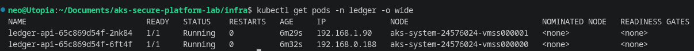

From here, the no-password proof
([Identity and Secrets](../theory/04-identity-and-secrets.md)), the
NetworkPolicy proof
([Zero-Trust Networking](../theory/05-zero-trust-networking.md)), and the
Pod Security Admission proof
([Admission Control](../theory/06-admission-control.md)) were all run
against this exact deployment.

## Phase 5: guardrails, and a real API migration mid-project

[Admission Control](../theory/06-admission-control.md) already covers the
Kyverno CEL-API story in detail. The practical result, once both policies
and the (Audit-mode) signature check were rewritten against the current
API and applied:

```bash
kubectl get namespacedvalidatingpolicy,namespacedimagevalidatingpolicy -n ledger
```

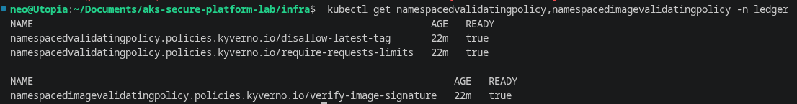

And the second live rejection test - a pod with no declared resource
requests or limits, otherwise PSA-compliant, specifically to isolate the
Kyverno rule being tested:

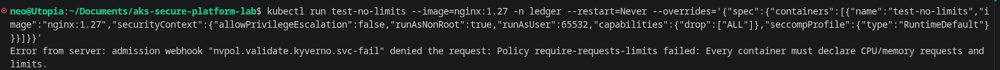

## Phase 6: observability, built and actually watched

`kube-prometheus-stack` was installed via Helm, the `PrometheusRule` from
[Observability](../theory/07-observability.md) applied:

```bash
kubectl get prometheusrule -n ledger
```

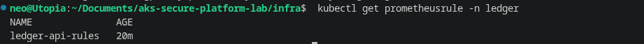

Beyond the custom `ledger-api` RED dashboard shown in the theory chapter,
`kube-prometheus-stack` ships a whole set of pre-built dashboards for
free, and all of them worked immediately, proving the whole observability
stack - not just one app's dashboard - was correctly wired up:

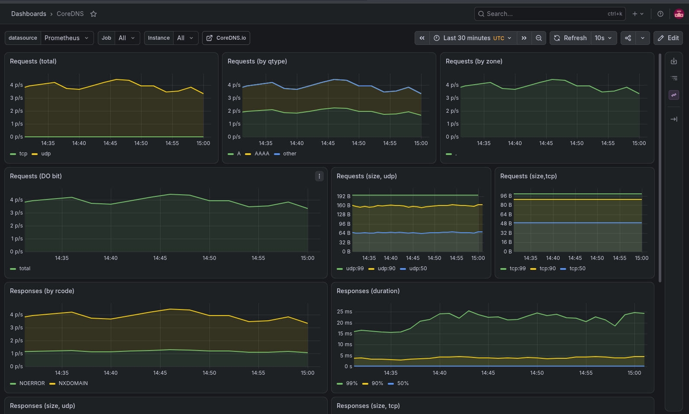
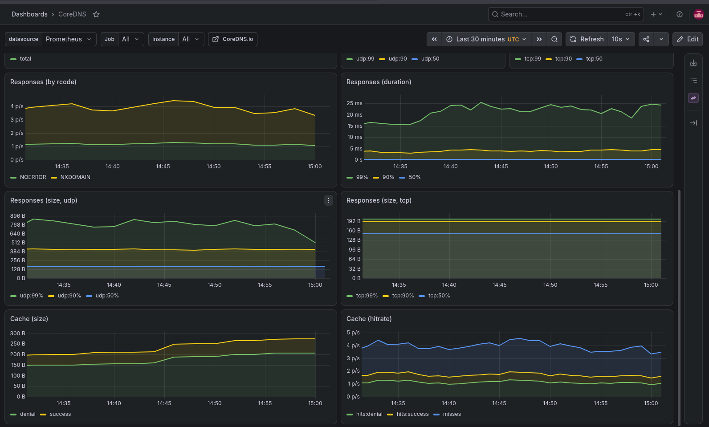
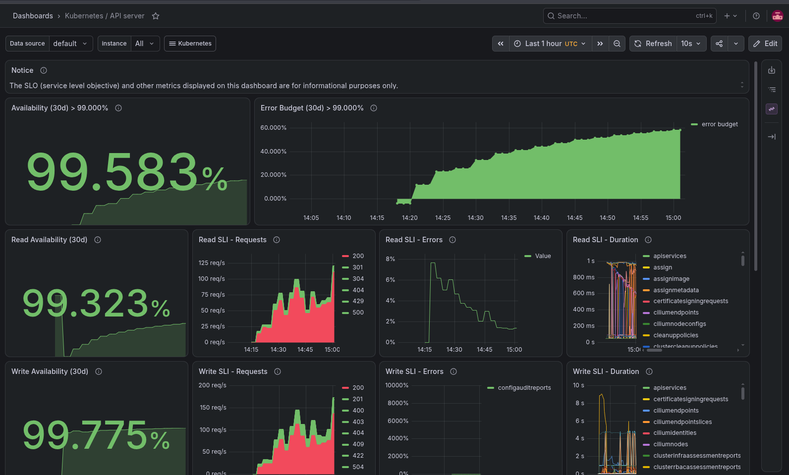
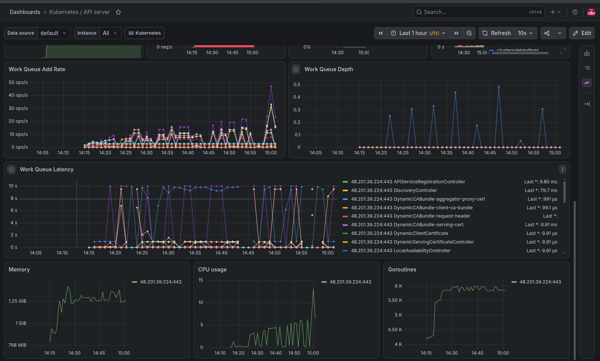

One particularly useful screen for debugging the `ServiceMonitor` bug
described in the theory chapter: Prometheus's own "Target Sync" panel,
explicitly listing `serviceMonitor/ledger/ledger-api/0` as a legend
entry once the fix landed - direct, visual confirmation the target was
finally being tracked:

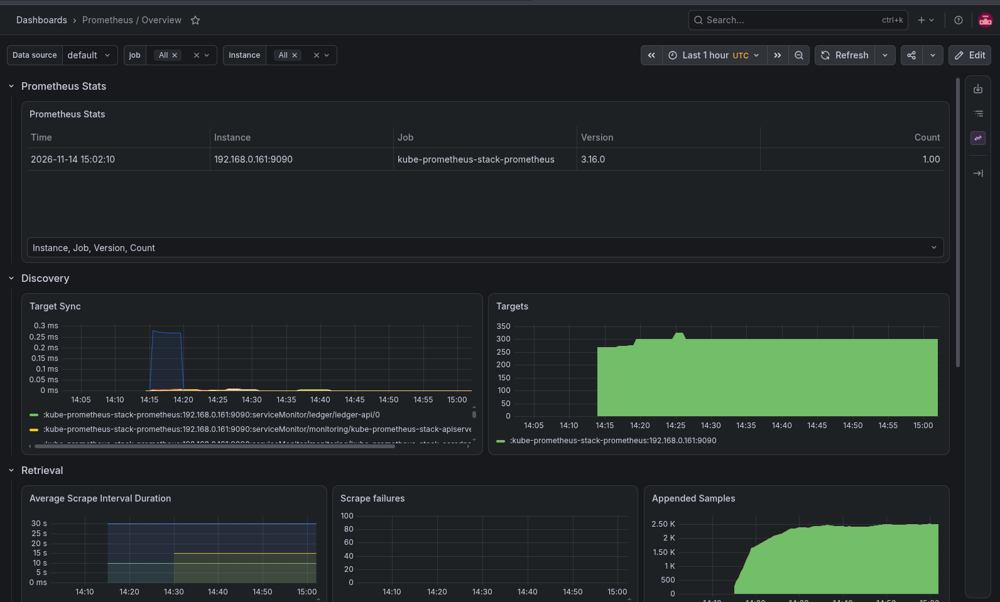
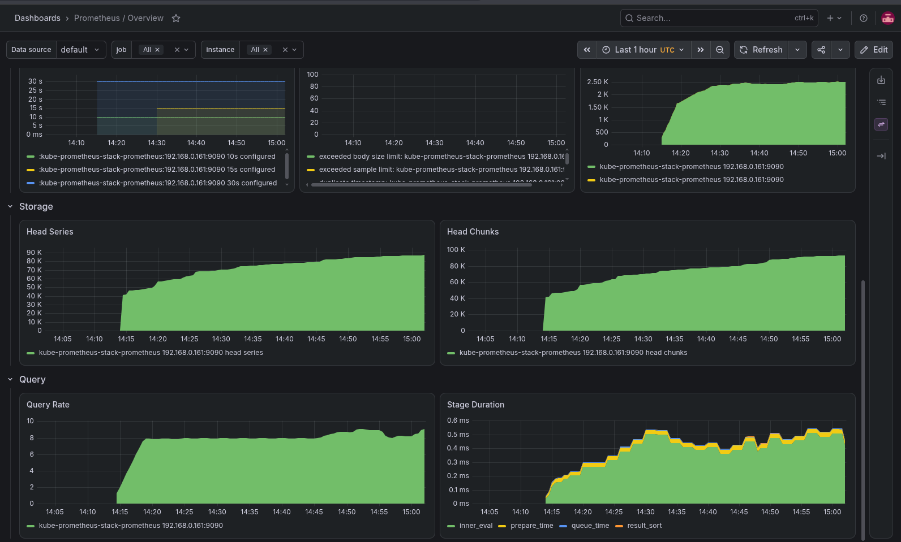

And the dashboards that directly explain the capacity lesson from Phase
3 - a per-namespace breakdown of exactly how much CPU and memory
`gatekeeper-system`, `kube-system`, `kyverno`, `ledger`, `monitoring` and
`trivy-system` were each actually using, side by side:

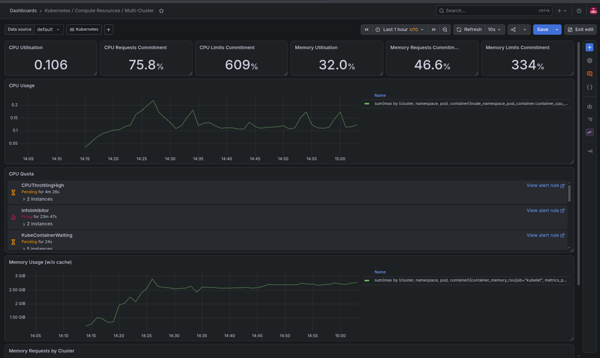
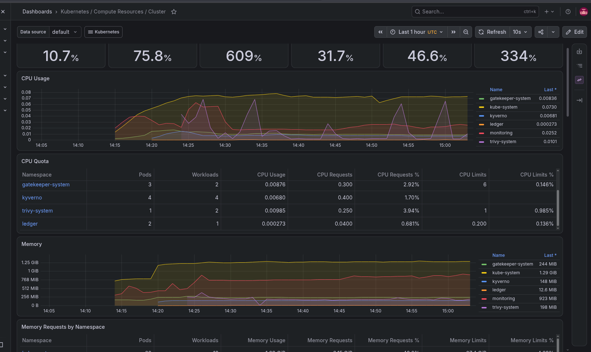
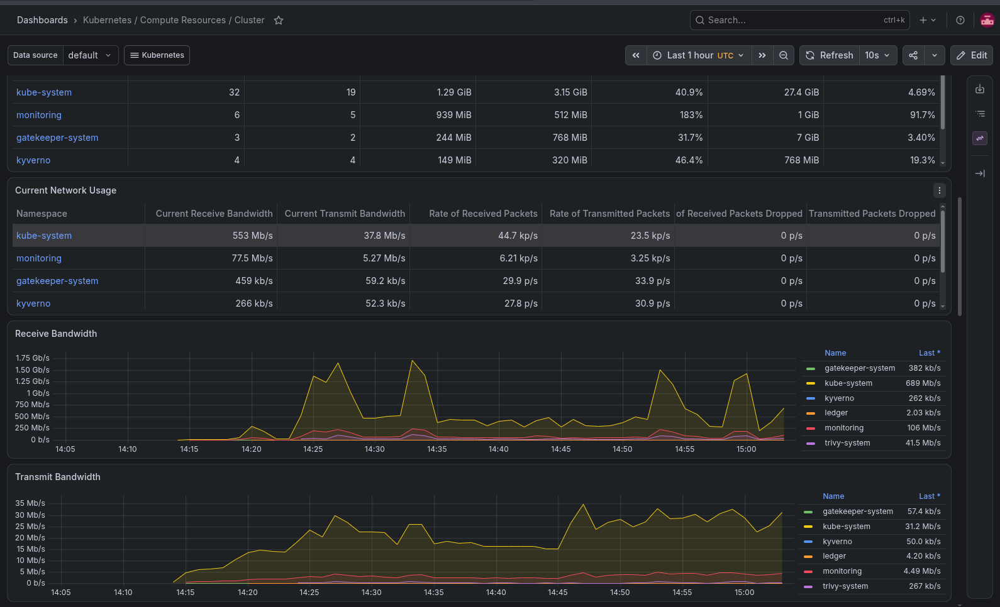

## Phase 7: the vulnerability loop, and what it actually found

Trivy Operator was installed and left to continuously scan the cluster:

```bash
kubectl get vulnerabilityreports -A
```

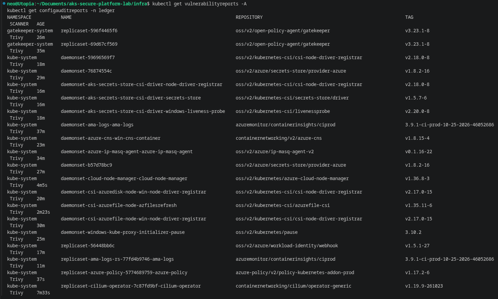

```bash
kubectl get configauditreports -n ledger
```

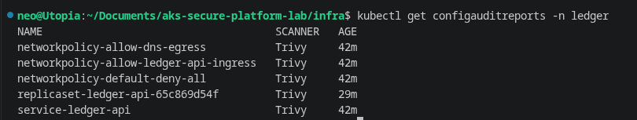

The CVE-count table shown in
[Vulnerability Management](../theory/08-vulnerability-management.md) is
the same data, reshaped for readability:

```bash
kubectl get vulnerabilityreports -A -o custom-columns='NAMESPACE:.metadata.namespace,NAME:.metadata.name,CRITICAL:.report.summary.criticalCount,HIGH:.report.summary.highCount,MEDIUM:.report.summary.mediumCount,LOW:.report.summary.lowCount'
```

## Tearing it all down

The single most important command of the whole session, run at the end
of every work block, without exception: a running cluster bills by the
hour whether or not anyone is actively using it.

```bash
cd infra
terraform plan -destroy -out=tfdestroy
terraform apply "tfdestroy"
az resource list -g rg-ledger-lab -o table   # confirm genuinely empty
```

One extra wrinkle worth noting for anyone following this exact path:
Azure's Container Insights add-on auto-creates its own
`Microsoft.OperationsManagement/solutions` resource and
`Microsoft.Insights/dataCollectionRules` resource inside the resource
group - neither one tracked in Terraform's state, because Terraform
never created them directly (AKS created them as a side effect of
enabling the monitoring add-on). `terraform destroy` correctly refuses to
delete a resource group that still contains resources it doesn't know
about, as a safety feature - the fix is a one-line `az resource delete`
against the specific leftover resource, then re-running the destroy.

## What this whole log adds up to

Every single screenshot above corresponds to a real command, run against
a real, billed, live Azure subscription, in order, with real failures in
between that had to be actually diagnosed and actually fixed - not a
curated, cleaned-up retelling. That's deliberate. The theory chapters
explain the concepts cleanly because concepts *are* clean; the real work
of building anything never is, and writing that down honestly is the
whole point of keeping a journal like this one.
