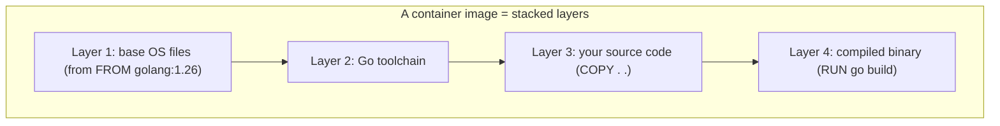

# 1. Containers and Images: Naive vs Hardened

## Before containers: the problem

Before any of this makes sense, go back to the actual problem containers
solve. You write an app. It works on your laptop. You hand it to a
teammate, or you deploy it to a server, and it breaks - because your
laptop has Python 3.12 and the server has 3.9, or a library version is
different, or an environment variable is missing. "Works on my machine" is
the oldest joke in software for a reason.

A container solves this by packaging the app **together with everything it
needs to run** - the runtime, the libraries, the configuration - into one
unit that behaves the same way everywhere: your laptop, a teammate's
laptop, a server in a data center, a cloud VM. It's not a virtual machine
(no separate operating system booting up inside it); it's a process on the
host machine's own Linux kernel, with two Linux kernel features isolating
it from everything else on that machine:

- **Namespaces** - give the process its own view of certain things: its
  own filesystem root, its own network interfaces, its own list of
  processes (it thinks it's PID 1, even though the host sees it as, say,
  PID 48213). It can't see or touch what's outside its namespace.
- **cgroups** (control groups) - limit how much CPU, memory, and other
  resources the process is allowed to use, so one container can't starve
  everything else on the machine.

That's it. A container is a regular Linux process, wearing a namespace and
cgroup "suit" that makes it feel like it's alone on its own machine, when
really it's sharing the host kernel with every other container next to it.

## What an image actually is

A **container image** is the packaged, ready-to-run version of all of
that: a tarball of filesystem layers, stacked on top of each other, plus
metadata (what command to run, what user to run as, what ports it expects
to use). When you run a container, the container runtime (Docker,
`containerd`, etc.) unpacks those layers into a filesystem, starts a
process inside the isolation described above, and that process sees the
unpacked layers as its own root filesystem (`/`).

Each layer is the result of one instruction in a `Dockerfile` - the recipe
that builds the image. `FROM golang:1.26` starts from a published image
that already has the Go toolchain. `COPY . .` adds a layer with your
source code. `RUN go build` adds a layer with a compiled binary. Layers
stack; later layers can see everything in earlier layers, but not vice
versa.



This matters for security for a very concrete reason: **every layer you
include is something you're trusting, and something that can have known
vulnerabilities (CVEs).** If your base image layer includes a full
Debian or Ubuntu userland - `bash`, `apt`, `curl`, a hundred system
libraries you never call - every CVE ever found in any of those is now a
CVE in *your* image, whether your app uses that code or not.

## Building `ledger-api` the naive way

The naive way to containerize a Go app:

```dockerfile
FROM golang:1.26
WORKDIR /app
COPY . .
RUN go build -o ledger-api .
CMD ["go", "run", "."]
```

This works. It is also, by security standards, about as bad as it gets,
and it's worth being specific about exactly why:

- **`golang:1.26` is a full development image.** It has the entire Go
  compiler toolchain, a complete Debian base, package managers, a shell,
  and every tool needed to *build* software - none of which your app needs
  to *run*. All of that ships in the final image anyway.
- **It runs as root by default.** If someone finds a way to execute
  arbitrary code inside that container (a vulnerability in your app, a
  malicious dependency, anything), they get root inside the container -
  and depending on how the container is configured, that can be a short
  hop to root on the host.
- **It has a shell.** `bash` or `sh` being present means that if an
  attacker gets any form of code execution, they have an interactive
  environment to explore with, download more tools into, and pivot from.
  Remove the shell, and a huge category of post-exploitation techniques
  simply has nothing to run.
- **It's enormous.** A full Debian-plus-Go-toolchain image is well over a
  gigabyte. Every megabyte is something that has to be pulled over the
  network, stored, and scanned - and more importantly, every file in it is
  something that *could* have a vulnerability.

When this exact naive image was actually built and scanned with Trivy
(an open-source vulnerability scanner for container images), here's what
came back:

| Metric | Naive image |
|---|---|
| Size | 1.32 GB |
| HIGH/CRITICAL CVEs | 183 (182 HIGH, 1 CRITICAL) |
| Runs as | root (UID 0) |
| Has a shell | yes |

183 known vulnerabilities, in an image that just needs to serve a handful
of HTTP endpoints. Almost none of those CVEs are in *your* code - they're
in the Debian base layer, in packages you never call.

## Building it the hardened way

The hardened version uses two ideas together: **multi-stage builds** and a
**distroless base image**.

### Multi-stage builds

A multi-stage Dockerfile has more than one `FROM` line. Each `FROM` starts
a fresh stage, and later stages can selectively copy *specific files* out
of earlier stages - without carrying along everything else that earlier
stage contained.

```dockerfile
# Stage 1: "builder" - has the full Go toolchain, but we throw this stage away
FROM golang:1.26 AS builder
WORKDIR /app
COPY . .
RUN CGO_ENABLED=0 go build -trimpath -ldflags="-s -w" -o ledger-api .

# Stage 2: the actual image we ship - starts completely fresh
FROM gcr.io/distroless/static-debian12:nonroot
COPY --from=builder /app/ledger-api /ledger-api
USER 65532:65532
EXPOSE 8080
ENTRYPOINT ["/ledger-api"]
```

The first stage is a scratchpad: it has the whole Go compiler, builds the
binary, and then is discarded entirely. Only the single line
`COPY --from=builder /app/ledger-api /ledger-api` reaches into that stage
and pulls out exactly one file: the compiled binary. None of the compiler,
none of the build tools, none of the Debian userland from that stage ends
up in the final image.

A few of the build flags are worth knowing, because they're not
decorative:

- `CGO_ENABLED=0` - produces a fully static binary with no dependency on
  the C standard library (`glibc`) being present at runtime. This is what
  makes it possible to run the binary on an image that has almost nothing
  else in it.
- `-trimpath` - strips local filesystem paths out of the compiled binary
  (so it doesn't leak `/home/yourname/...` into the binary's debug info).
- `-ldflags="-s -w"` - strips debug symbols, making the binary smaller.

### Distroless: a base image with (almost) nothing in it

`gcr.io/distroless/static-debian12:nonroot` is a Google-maintained base
image that contains **no shell, no package manager, no system utilities -
just the absolute minimum C library files needed to run a static binary**,
plus a non-root user already configured. "Distroless" means exactly what
it says: there is no Linux distribution's userland in there, just enough
to run your binary and nothing else.

Why this matters in practice: if an attacker ever gets code execution
inside this container, there is no `sh`, no `bash`, no `curl`, no `wget`,
no package manager to install any of those with. They can't "just open a
shell and look around." The attack surface for anything *after* initial
code execution collapses to almost nothing.

### Pinning by digest, not by tag

Notice the base image in the real project is referenced by its exact
cryptographic digest, not just a tag like `:nonroot`:

```
gcr.io/distroless/static-debian12:nonroot@sha256:afa5c872c891853ca7fcf1f12c3edb23f7eeef36189728842dd51042ff57f7ab
```

A tag like `:nonroot` can be re-pointed by the image's publisher to a
completely different set of bytes tomorrow, without you doing anything. A
digest is a hash of the exact content - it can never silently change. If
you pin by digest, the image you tested is *exactly* the image you ship,
forever, unless you deliberately update the pin yourself. This is the same
reasoning used later in this session for pinning GitHub Actions by commit
SHA instead of a mutable version tag (see the CI chapters in the build
log) - it's a recurring theme in supply-chain security: anything mutable
that you depend on is something someone else can change out from under
you.

### Running as a non-root, numeric user

`USER 65532:65532` switches the container's default process owner from
root to an unprivileged, numeric user ID. Distroless images conventionally
use 65532 for their `nonroot` user. Running as non-root means that even if
an attacker achieves code execution inside the container, that code runs
with no special privileges - it can't modify system files, can't bind to
privileged ports below 1024 (which is also why this app listens on 8080,
not 80), and is far more contained if it ever tries to escalate further.

### The results, side by side

| | naive | hardened |
|---|---|---|
| Size | 1.32 GB | 19.5 MB |
| HIGH/CRITICAL CVEs | 183 (182 HIGH, 1 CRITICAL) | 0 |
| Runs as | root (UID 0) | 65532:65532 |
| Has a shell? | yes | no (`exec: "sh": executable file not found in $PATH`) |

Same application. Same functionality, verified with the same test suite.
The only difference is *how the image is built* - and the risk profile
changes completely.

## Why does any of this actually matter? (the "so what")

It's easy to read a table like that and nod along without internalizing
why it's worth the extra Dockerfile complexity. A few concrete reasons,
each tied to a real failure mode:

- **A smaller attack surface means fewer things can go wrong.** Every
  binary, every library, every shell utility present in an image is a
  potential vulnerability *and* a potential tool for an attacker who gets
  in. Distroless removes almost all of them.
- **No shell means a huge class of attacks simply doesn't work.** Many
  real-world container compromises rely on the attacker getting a shell to
  explore, download a second-stage payload, or pivot. If there's no shell
  and no package manager, "curl the malware and run it" isn't an option.
- **Non-root by default limits the blast radius.** If the worst happens
  and an attacker gets code execution, running as a non-privileged user
  means they can't modify the container's own filesystem (especially
  combined with a read-only root filesystem, covered in the Kubernetes
  deployment chapters), can't bind privileged ports, and generally can't
  do much beyond what the app itself was already allowed to do.
- **Fewer CVEs means less to patch, less to triage, less noise.** A
  vulnerability scanner (covered properly in the
  [Vulnerability Management](08-vulnerability-management.md) chapter)
  finding 183 issues in an image is not actionable - nobody will read
  that list. A scanner finding zero means every *new* finding that shows
  up later is real, specific, and worth looking at immediately.
- **This is also just smaller and faster.** A 19.5 MB image pulls and
  starts in a fraction of the time a 1.32 GB image does. Security and
  performance point the same direction here, which is not always true but
  is nice when it happens.

## How to actually prove this, not just claim it

None of the numbers above were taken on faith - each row in that table
came from running a real command and reading the real output:

```bash
docker images                                             # Size
trivy image --severity HIGH,CRITICAL <image>              # CVE count
docker inspect -f '{{.Config.User}}' <image>               # who it runs as
docker run --rm --entrypoint sh <image>                    # is there a shell?
```

`trivy` deserves its own mention here, since it comes up constantly in
this session: it's an open-source scanner that reads an image's layers,
compares every package and library version it finds against databases of
known vulnerabilities (CVEs), and reports what it finds, with a severity
(LOW/MEDIUM/HIGH/CRITICAL). It's the same tool used later for scanning the
Terraform infrastructure code itself, and for continuously scanning
everything running inside the cluster - one tool, three different jobs,
all in the [Vulnerability Management](08-vulnerability-management.md)
chapter.

## What's next

With a hardened image built, the next question is: where does it actually
run? That's [Kubernetes on Azure: AKS and Cilium Networking](02-aks-and-networking.md).
