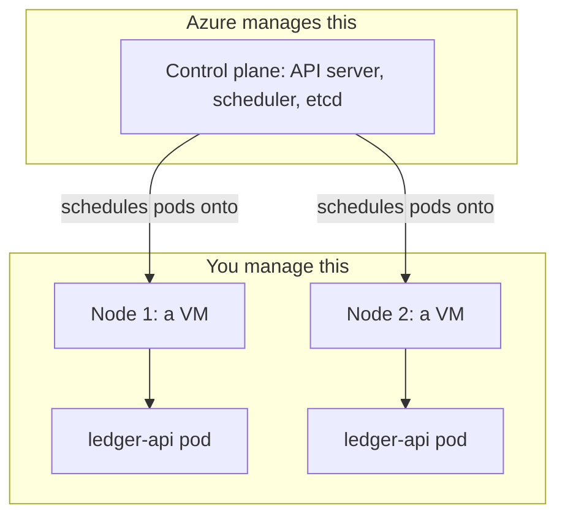
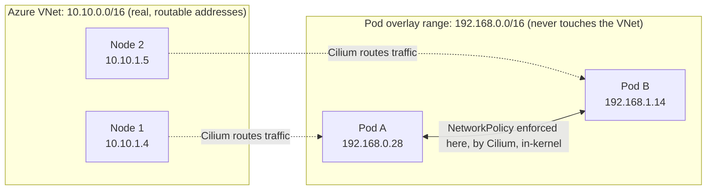

# 2. Kubernetes on Azure: AKS and Cilium Networking

## A 30-second recap of Kubernetes

Session 1 ([Kubernetes Basics 101](../../01-kubernetes-basics-101/index.md))
covers this properly, but the short version, so this chapter stands on its
own: Kubernetes is a system that runs containers across a cluster of
machines (**nodes**). You describe what you want - "run 2 copies of this
container, give each one this much CPU and memory, expose it on this
port" - and Kubernetes figures out how to make that true and keep it true,
restarting things that crash and rescheduling things if a node dies. The
smallest unit it runs is a **Pod** (one or more containers that share a
network address). A **cluster** has a **control plane** (the "brain" -
decides what goes where) and **nodes** (the "muscle" - actually run the
containers).

## What does AKS actually add?

Running your own Kubernetes cluster from scratch means standing up and
maintaining the control plane yourself: the API server, the scheduler,
`etcd` (the cluster's database), certificate rotation, upgrades, backups -
a genuinely hard operational job, and not where most teams want to spend
their time.

**AKS (Azure Kubernetes Service)** is Azure's *managed* Kubernetes: Azure
runs and maintains the control plane for you (and for a basic "Free" tier
cluster, doesn't even charge you for it - you only pay for the worker
nodes, which are regular Azure VMs). You still fully control what runs
*inside* the cluster; Azure just takes the operational burden of the
control plane itself off your plate, and wires in deep integration with
the rest of Azure: Azure Active Directory (Entra ID) for authentication,
Azure networking for the cluster's VNet, Azure Monitor for logs and
metrics, Azure Policy for compliance, and - central to this entire
session - **managed identities** that let a pod authenticate to other
Azure services without ever holding a password (covered properly in
[Identity and Secrets](04-identity-and-secrets.md)).



## The networking decision that everything else depends on

Every pod needs an IP address. Where that IP address comes from, and
whether traffic between pods can be controlled, is one of the first
decisions AKS asks you to make - and it quietly shapes everything that
comes later in this session, especially the zero-trust networking in
chapter 5. There are three real options:

### Option 1: kubenet (the simplest, and the one to avoid here)

Kubenet gives pods IP addresses from a separate, internal range, hidden
behind the nodes using basic Linux routing. It's simple and doesn't eat
into your Azure VNet's address space - but it has two real problems for
this project: it doesn't enforce `NetworkPolicy` on its own (you'd have to
bolt on a separate network policy engine like Calico just to get
default-deny networking working at all), and it has a documented scaling
ceiling of a few hundred nodes because of how it manages routes.

### Option 2: classic Azure CNI (every pod gets a real VNet IP)

Classic Azure CNI gives every single pod a real, routable IP address from
your Azure VNet - the same address space your VMs, databases, and
everything else live in. This is powerful (anything in the VNet can talk
to a pod directly) but expensive in IP addresses: a modest VNet subnet can
run out of available addresses fast once you're running dozens of pods per
node, especially with autoscaling in play.

### Option 3: Azure CNI Overlay with Cilium (what this project uses)

**Azure CNI Overlay** solves the IP-exhaustion problem by giving pods IP
addresses from a separate "overlay" range that exists *on top of* the VNet
but never actually occupies VNet address space. In this project, the VNet
is `10.10.0.0/16` and the pod overlay range is a completely separate
`192.168.0.0/16` - pods get addresses from the overlay range, nodes
(VMs) get real VNet addresses, and a thin software layer handles routing
packets between the two.

**Cilium** is the piece that handles that routing - and a lot more. It's
an open-source networking project built on **eBPF**, a Linux kernel
technology that lets small, safe programs run directly inside the kernel
to inspect and filter network packets with very little overhead (instead
of routing decisions happening in slower, traditional user-space
processes). Practically, for this project, the one feature that matters
most is: **Cilium enforces `NetworkPolicy` natively**, with nothing extra
to install. Plain kubenet doesn't give you this at all. Classic Azure CNI
can, but needs Calico bolted on separately. Cilium gives it out of the
box, as part of choosing this networking mode.



## The actual Terraform for this

Here's the real configuration block from this project's `infra/aks.tf`,
and what each line is actually doing:

```hcl
network_profile {
  network_plugin      = "azure"        # use Azure CNI (not kubenet)
  network_plugin_mode = "overlay"      # specifically, Overlay mode -
                                        # pods get IPs from pod_cidr below,
                                        # NOT from the VNet's address space
  network_data_plane  = "cilium"       # Azure CNI Powered by Cilium
  network_policy      = "cilium"       # explicit: Cilium enforces NetworkPolicy
  pod_cidr            = "192.168.0.0/16" # the overlay range - must not
                                          # overlap the VNet or service_cidr
  service_cidr        = "10.100.0.0/16"  # cluster-internal Service IPs
  dns_service_ip      = "10.100.0.10"
}
```

Two address ranges that must never overlap, or the cluster simply won't
schedule traffic correctly: the VNet's own range (`10.10.0.0/16`, where the
node VMs live) and the pod overlay range (`192.168.0.0/16`). A third range,
`service_cidr`, is for Kubernetes **Services** - the stable, internal
virtual IPs that let one pod reliably reach another even as the actual
pods behind them come and go (see Session 1 for Services in general).

## Why this matters for the rest of the session

Everything about locking down which pods can talk to which - the entire
point of chapter 5 - only works because of this choice. A `NetworkPolicy`
manifest with no engine enforcing it is just a YAML file that does
nothing. Picking Cilium here is what turns "we wrote a default-deny
network policy" from a wish into an actual, tested, enforced guarantee -
proven later in this session by literally trying to reach a pod from
somewhere it shouldn't be allowed to, and watching it fail.

## What's next

With a cluster and its networking model decided, the next question is:
how was any of this actually built, reliably and repeatably, instead of
clicked together by hand in the Azure Portal? That's
[Infrastructure as Code with Terraform](03-terraform-iac.md).
