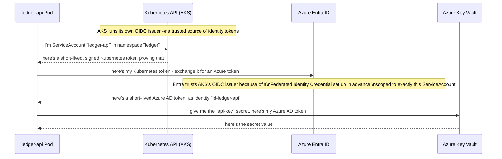
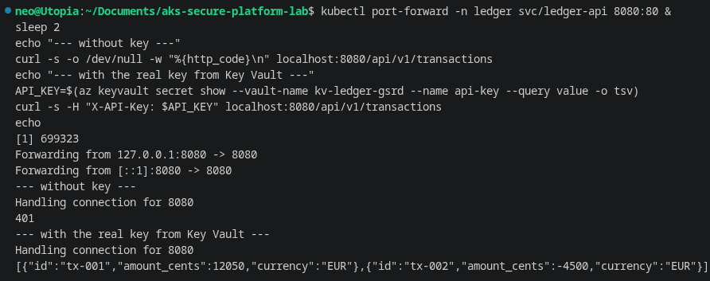

# 4. Identity and Secrets: Workload Identity

This is the chapter the whole project is really built around. The goal,
stated plainly: `ledger-api` needs a secret API key to authenticate
requests, and **that key must never exist anywhere it could leak** - not
in the image, not in a Kubernetes manifest, not in a CI/CD pipeline
variable, not typed by a human into a config file.

## The usual ways people handle secrets, and why each one is a problem

### "Just put it in an environment variable"

```yaml
env:
  - name: API_KEY
    value: "sk_live_abc123..."
```

This secret is now sitting in plain text in a YAML file. If that file is
in Git, it's in Git history forever, even if you delete it later - Git
never truly forgets. Anyone with read access to the cluster can run
`kubectl describe pod` and read it straight out.

### "Use a Kubernetes Secret instead"

A Kubernetes `Secret` object looks safer - the value is base64-encoded
when you look at it with `kubectl get secret -o yaml`. This is the single
most common misunderstanding in Kubernetes security: **base64 is not
encryption.** It's just a text encoding, exactly as reversible as writing
something backwards. `echo c2tfbGl2ZV9hYmMxMjMuLi4= | base64 -d` recovers
the original secret instantly, no key needed. By default, Kubernetes
`Secret` objects also aren't encrypted at rest in `etcd` (the cluster's
database) unless you've specifically configured encryption-at-rest for
the cluster. A `Secret` object is a slight improvement in *handling*
(separated from the Pod spec, can have its own RBAC rules) but it is not,
by itself, cryptographic protection.

### "Put it in a CI/CD secret variable"

Better than hardcoding it, but now the secret exists in at least two
places (the CI system's secret store, and wherever it gets injected at
build or deploy time), and every pipeline step, every log line that
accidentally echoes an environment variable, every person with access to
pipeline configuration, is a potential leak point.

Every one of these approaches shares the same underlying flaw: **the
secret has to exist somewhere, as a static, copyable value, before the
application can use it.** Once something is a static value sitting in
storage, it can be copied, logged, leaked, or stolen - and once stolen, it
stays valid until someone notices and manually rotates it.

## The actual solution: don't store a secret to get a secret

This project's answer removes the static value from the equation entirely,
using three pieces together: **Azure Key Vault**, **Managed Identity**,
and **Workload Identity Federation**.

### Azure Key Vault

A dedicated, access-controlled store for secrets, keys, and certificates.
Secrets at rest in Key Vault are genuinely encrypted (not just encoded),
and every single read or write is logged. Access to it is controlled by
Azure's own role-based access control (RBAC) - "who is allowed to read
this specific secret" is itself a policy, reviewable and auditable, not an
if-you-have-the-file-you-have-the-secret situation.

```hcl
resource "azurerm_key_vault" "main" {
  name                       = "kv-ledger-${random_string.kv_suffix.result}"
  tenant_id                  = data.azurerm_client_config.current.tenant_id
  sku_name                   = "standard"
  rbac_authorization_enabled = true   # access via Azure RBAC roles, not legacy access policies
}
```

### Managed Identity: an identity for software, not a person

A **Managed Identity** is an identity Azure creates and manages for a
piece of software (a VM, a function, in this case a Kubernetes pod) to use
when calling other Azure services - with **no password, key, or secret
that a human ever handles**. Azure itself manages the underlying
credential material and its rotation, entirely behind the scenes. There
are two kinds:

- **System-assigned** - tied 1:1 to a specific resource's lifecycle (the
  resource itself has the identity, and deleting the resource deletes the
  identity).
- **User-assigned** - created as its own independent Azure resource, which
  can then be attached to one or more things. This project uses a
  user-assigned identity (`id-ledger-api`), because the identity needs to
  outlive and be referenced independently from any one specific resource.

### Workload Identity Federation: how a *pod* gets to use that identity

This is the actual mechanism, and it's worth walking through slowly,
because it's the single most important flow in this whole session.



Every piece of this matters:

1. **AKS runs its own OIDC issuer.** OIDC (OpenID Connect) is a standard
   way of saying "here is a token, signed by me, that proves who holds
   it." Enabling this on the cluster (`oidc_issuer_enabled = true` in
   Terraform) gives AKS a trusted identity of its own, with a public URL
   other services can use to verify tokens it issues.
2. **A Federated Identity Credential links a specific Kubernetes identity
   to a specific Azure identity, in advance.** This is the piece that
   makes the whole thing trustworthy rather than wide open: it says, very
   precisely, "trust tokens from AKS's OIDC issuer, but only if the token
   claims to be exactly `system:serviceaccount:ledger:ledger-api` - no
   other ServiceAccount, in no other namespace, gets this trust."

   ```hcl
   resource "azurerm_federated_identity_credential" "ledger_api" {
     name                      = "fic-ledger-api"
     user_assigned_identity_id = azurerm_user_assigned_identity.ledger_api.id
     audience                  = ["api://AzureADTokenExchange"]
     issuer                    = azurerm_kubernetes_cluster.main.oidc_issuer_url
     subject                   = "system:serviceaccount:ledger:ledger-api"
   }
   ```

3. **The pod exchanges a Kubernetes token for an Azure token, entirely
   automatically.** A small webhook (`azure-wi-webhook-controller-manager`,
   installed as part of enabling `workload_identity_enabled = true` on the
   cluster) watches for pods labeled `azure.workload.identity/use: "true"`
   whose ServiceAccount is annotated with an identity's client ID, and
   quietly injects everything the application needs to perform that
   exchange, as environment variables and a projected, auto-rotating token
   file. The application code itself doesn't need to know any of this is
   happening.
4. **The resulting Azure AD token is short-lived.** It expires. There is
   nothing long-lived to steal - even if someone intercepted one of these
   tokens, it would already be close to useless by the time they could do
   anything with it.
5. **Key Vault is given a role, not a password check.** The identity
   `id-ledger-api` is granted the **Key Vault Secrets User** role on the
   vault - an Azure RBAC role assignment, not a shared secret:

   ```hcl
   resource "azurerm_role_assignment" "ledger_api_kv_reader" {
     scope                = azurerm_key_vault.main.id
     role_definition_name = "Key Vault Secrets User"
     principal_id         = azurerm_user_assigned_identity.ledger_api.principal_id
   }
   ```

## How the secret actually gets into the pod's filesystem

The pod doesn't call the Key Vault API itself. A Kubernetes component
called the **Secrets Store CSI Driver** (with an **Azure Key Vault
provider** plugin) does that on the pod's behalf, using exactly the
workload identity flow above, and mounts the result as a file inside the
container:

```yaml
apiVersion: secrets-store.csi.x-k8s.io/v1
kind: SecretProviderClass
metadata:
  name: ledger-api-secrets
  namespace: ledger
spec:
  provider: azure
  parameters:
    clientID: "<the identity's client ID>"
    keyvaultName: "<the Key Vault's name>"
    tenantId: "<the Azure AD tenant ID>"
    objects: |
      array:
        - |
          objectName: api-key
          objectType: secret
```

The application code reads this exactly like it would read any local
file:

```go
data, err := os.ReadFile("/mnt/secrets/api-key")
```

It has no idea Key Vault, workload identity, or OIDC federation exist.
From the app's point of view, the secret is just a file that happens to
be there - which is exactly the point: the complexity lives in
infrastructure, not in application code.

### Rotation, without a restart

The CSI driver was configured (`secret_rotation_enabled = true` on the
Key Vault Secrets Provider add-on) to poll Key Vault roughly every two
minutes and update the mounted file in place if the secret's value has
changed in Key Vault. Rotate the secret in Key Vault, and the running
pod's mounted file updates itself within that window - no redeploy, no
restart, no window where the old secret has to coexist with application
code that was specifically rewritten to handle a rotation event. The app
simply re-reads the file on its next request.

## Proof, not a claim

This is one of the most important things to verify directly rather than
trust on paper - a security claim with no test behind it is just a
sentence. Here's exactly what was run against the real, deployed app:

```bash
echo "--- without the key ---"
curl -s -o /dev/null -w "%{http_code}\n" localhost:8080/api/v1/transactions
echo "--- with the real key, read live from Key Vault ---"
API_KEY=$(az keyvault secret show --vault-name <kv-name> --name api-key --query value -o tsv)
curl -s -H "X-API-Key: $API_KEY" localhost:8080/api/v1/transactions
```



No request succeeds without the key. The key used to succeed was never
typed by a human or stored in any file in this repository - it was read,
at the moment of the test, straight out of Key Vault, using `az` CLI
credentials entirely separate from the pod's own identity. Two completely
different paths (a human with `az login`, and a pod with workload
identity) both end up proving the same thing: the only place this secret
actually lives is Key Vault.

## What's next

The secret is safe. Now: who's allowed to talk to this pod over the
network in the first place? That's
[Zero-Trust Networking: NetworkPolicy](05-zero-trust-networking.md).
