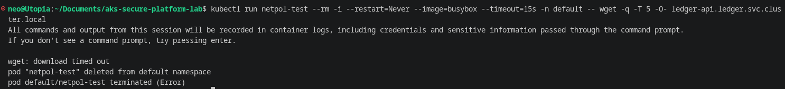

# 5. Zero-Trust Networking: NetworkPolicy

## The default Kubernetes network is wide open

Here's something that surprises a lot of people the first time they hear
it: **by default, in a plain Kubernetes cluster, every pod can talk to
every other pod, on any port, across every namespace.** There is no
built-in network isolation between workloads unless you add it yourself.
A compromised pod in a low-risk namespace can, by default, freely reach
your database, your secrets-management tooling, your payment service -
anything else running in the cluster.

This matters because of a very specific attack pattern: **lateral
movement.** An attacker rarely gets what they want from the first thing
they compromise. They get a foothold somewhere low-value (an outdated
dependency in some side service, a misconfigured debug endpoint) and then
move sideways from there, probing the network for something more
valuable. A flat, fully-open network is lateral movement's best friend.

## Zero trust, in one sentence

**Zero trust**, applied to networking, means: nothing is allowed to talk
to anything else by default, regardless of which network or namespace
it's "inside" - every single allowed connection has to be explicitly
declared. Being on the same cluster, even in the same namespace, earns no
automatic trust. This is the opposite of the traditional "castle and
moat" model (strong perimeter, free movement once inside) - here, every
internal boundary is treated like a perimeter of its own.

## What a NetworkPolicy resource actually looks like

A `NetworkPolicy` is a Kubernetes object that two things together: which
pods it applies to (`podSelector`), and what traffic is allowed to or from
those pods (`ingress`/`egress` rules). Critically: **a `NetworkPolicy`
with an empty `podSelector: {}` applies to every pod in its namespace**,
and once *any* `NetworkPolicy` selects a pod for a given direction
(ingress or egress), that direction becomes **deny-by-default** for that
pod - only traffic matching an explicit rule gets through. If no policy
selects a pod at all, that pod stays fully open in that direction, exactly
as if no policies existed.

This project uses three policies together, in the `ledger` namespace,
read in the order that makes most sense to reason about:

### 1. Deny everything, first

```yaml
apiVersion: networking.k8s.io/v1
kind: NetworkPolicy
metadata:
  name: default-deny-all
  namespace: ledger
spec:
  podSelector: {}                         # every pod in this namespace
  policyTypes: ["Ingress", "Egress"]      # both directions become deny-by-default
```

With just this one policy applied, every pod in `ledger` can neither
receive nor send a single packet - total lockdown. Nothing works yet, on
purpose. Everything after this is an explicit, narrow exception.

### 2. Allow DNS - or nothing resolves

The very first thing almost any pod needs to do is resolve a DNS name
(even just to find the Kubernetes API server, or another service by
name). Without an explicit allow for this, the deny-all policy above
blocks DNS lookups too, and everything else quietly breaks in a way
that's genuinely confusing to debug if you don't already know this is the
cause - "why is my app hanging on startup?" is often "because it can't
even resolve `kube-dns`."

```yaml
apiVersion: networking.k8s.io/v1
kind: NetworkPolicy
metadata:
  name: allow-dns-egress
  namespace: ledger
spec:
  podSelector: {}
  policyTypes: ["Egress"]
  egress:
    - to:
        - namespaceSelector:
            matchLabels:
              kubernetes.io/metadata.name: kube-system   # where CoreDNS lives
      ports:
        - protocol: UDP
          port: 53
        - protocol: TCP
          port: 53
```

`kubernetes.io/metadata.name` is a label Kubernetes automatically applies
to every namespace, matching the namespace's own name - a reliable way to
target "traffic destined for the `kube-system` namespace specifically"
without having to label anything by hand.

### 3. Allow exactly the traffic the app actually needs to receive

```yaml
apiVersion: networking.k8s.io/v1
kind: NetworkPolicy
metadata:
  name: allow-ledger-api-ingress
  namespace: ledger
spec:
  podSelector:
    matchLabels:
      app: ledger-api            # only pods labeled app=ledger-api
  policyTypes: ["Ingress"]
  ingress:
    - from:
        - namespaceSelector:
            matchLabels:
              kubernetes.io/metadata.name: ledger        # same-namespace traffic
        - namespaceSelector:
            matchLabels:
              kubernetes.io/metadata.name: monitoring    # Prometheus scraping /metrics
      ports:
        - protocol: TCP
          port: 8080
```

This is the entire allow-list for the app: incoming traffic on port 8080,
and only from the `ledger` namespace itself or the `monitoring` namespace
(where Prometheus runs, and needs to reach `/metrics` - see
[Observability](07-observability.md)). Nothing else, from nowhere else,
gets through.

## A genuinely surprising, real result

It would be easy to assume "same namespace" means some baseline of
implicit trust. It doesn't, here, and testing this directly produced a
result worth sitting with: **a plain test pod placed inside the `ledger`
namespace itself still could not reach anything**, because the
`default-deny-all` policy's `podSelector: {}` selects *every* pod in the
namespace for egress too - including that test pod - and nothing granted
it an explicit egress allow (only `ledger-api`'s own pods have an ingress
allow written for them; nothing in this namespace has a general-purpose
egress allow beyond DNS). The practical result: **nothing in this
namespace can call out to anything at all, except DNS**, unless it's
specifically given its own rule. That's a stricter result than most
people expect from "default-deny", and it's the correct, intentional
behavior of a genuinely zero-trust posture - "default-deny" isn't a
slogan here, it's checked line by line against every pod, every time.

## Proving it, not just declaring it

A YAML file that looks right and a YAML file that's actually being
enforced are two different things until tested. Here's the real test, run
against the live cluster, from a pod deliberately placed *outside* the
`ledger` namespace, trying to reach the service by its normal internal
DNS name:

```bash
kubectl run netpol-test --rm -i --restart=Never --image=busybox --timeout=15s -n default \
  -- wget -q -T 5 -O- ledger-api.ledger.svc.cluster.local
```



It hangs, then fails with `wget: download timed out`. No error message
about being refused - just silence, which is exactly what default-deny
looks like: the traffic isn't rejected with an explicit response, it
simply never arrives anywhere.

## Why this only works because of the networking chapter before it

None of this is specific to this project's YAML files - it's specific to
whether something in the cluster is actually *enforcing* `NetworkPolicy`
objects at all. This is the direct payoff of the decision made in
[Kubernetes on Azure: AKS and Cilium Networking](02-aks-and-networking.md):
Cilium, running as this cluster's networking data plane, is what reads
every `NetworkPolicy` object and actually drops packets that don't match
an explicit rule, in-kernel, on every packet, with very little overhead.
Write the exact same YAML on a cluster using plain kubenet with no policy
engine installed, and it would be accepted by the API server, show up
fine in `kubectl get networkpolicy`, and **enforce nothing at all** - a
false sense of security that's arguably worse than no policy file.

## What's next

The network is locked down. But a `NetworkPolicy` only controls traffic
*after* a pod is already running. What stops a badly-configured pod from
ever starting in the first place? That's
[Admission Control: Kyverno](06-admission-control.md).
