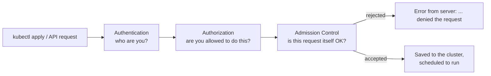
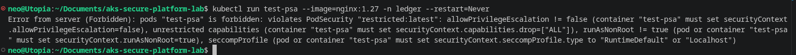
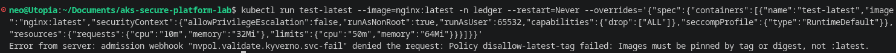

# 6. Admission Control: Pod Security Admission and Kyverno

## Where admission control fits

Every request to the Kubernetes API - including "please create this Pod" -
passes through a pipeline before it's ever actually saved:



Authentication answers "who are you?" Authorization (RBAC) answers "are
you allowed to create Pods at all?" **Admission control** is the last
gate, and it asks a different question entirely: "regardless of who you
are, is *this specific object* actually acceptable?" This is where "no
`:latest` tags" or "no root containers" get enforced - not as a
convention someone has to remember, but as something the cluster itself
refuses to violate.

## Pod Security Admission: Kubernetes' own built-in gate

**Pod Security Admission (PSA)** ships with Kubernetes itself - no
separate installation. It works off three predefined levels:

- **Privileged** - no restrictions at all.
- **Baseline** - blocks the most obviously dangerous settings (like
  running fully privileged containers), but otherwise permissive.
- **Restricted** - the strict end: requires non-root, requires dropping
  all Linux capabilities, requires a seccomp profile, forbids privilege
  escalation.

A namespace opts into a level with a label:

```yaml
apiVersion: v1
kind: Namespace
metadata:
  name: ledger
  labels:
    pod-security.kubernetes.io/enforce: restricted
```

This is the direct payoff of the hardened image work from
[chapter 1](01-containers-images.md): the `restricted` level requires
settings - non-root, no privilege escalation, dropped capabilities, a
seccomp profile - that the hardened Dockerfile and Kubernetes manifest
were already built around from the start. If this project had tried to
run the *naive* image (root by default, no security context set) in a
`restricted` namespace, admission would have rejected it outright, before
a single container ever started.

### Proving it

```bash
kubectl run test-psa --image=nginx:1.27 -n ledger --restart=Never
```

A plain pod, with no hardened `securityContext` at all, deployed into the
`restricted` namespace:



The rejection message is specific and actionable - it names exactly which
settings are missing (`allowPrivilegeEscalation`, dropped capabilities,
`runAsNonRoot`, a seccomp profile), not just "denied."

## Beyond PSA: Kyverno

PSA is powerful but narrowly scoped to pod-level security settings. It
has no concept of "don't use `:latest`" or "every container must declare
resource limits" or "only accept images signed by this specific CI
pipeline" - those are *business* rules, specific to how a given team or
project wants to operate, not universal Kubernetes security settings.
That's the gap **Kyverno** fills: a policy engine that lets you write
custom admission rules in Kubernetes-native YAML (no separate policy
language to learn, in its original design), and have them enforced the
same way PSA's rules are - at admission time, rejecting non-compliant
objects before they're ever saved.

### A real lesson: even a well-known tool's API can shift under you

Kyverno's older policy style (`kyverno.io/v1 ClusterPolicy`, with
declarative `validate`/`verifyImages` rules) is what most tutorials and
documentation online still show. Current Kyverno versions have actually
**removed execution of that type entirely** - not deprecated, removed. It
still exists as a *readable* object (`kubectl get clusterpolicy` still
works) but creating or updating one is rejected outright, with a message
pointing at its replacement: a newer, CEL-based policy API
(`policies.kyverno.io`), closely modeled on Kubernetes' own native
`ValidatingAdmissionPolicy` mechanism.

**CEL** (Common Expression Language) is a small, purpose-built expression
language - not a general programming language - designed for exactly this
kind of job: writing short, safe conditions that get evaluated against an
incoming object. A CEL policy for "reject the `:latest` tag" looks like
this:

```yaml
apiVersion: policies.kyverno.io/v1
kind: NamespacedValidatingPolicy
metadata:
  name: disallow-latest-tag
  namespace: ledger
spec:
  validationActions: [Deny]
  matchConstraints:
    resourceRules:
      - apiGroups: [""]
        apiVersions: ["v1"]
        operations: ["CREATE", "UPDATE"]
        resources: ["pods"]
  validations:
    - expression: >-
        object.spec.containers.all(c, !c.image.endsWith(':latest'))
      message: "Images must be pinned by tag or digest, not :latest."
```

Read the `expression` almost like English: "for every container
(`c`) in this pod's spec, its image must not end with `:latest`." `object`
is the incoming Pod being created or updated; `.all(...)` checks the
condition holds for every item in a list. If it evaluates to `false`,
`validationActions: [Deny]` means the request is rejected, with the given
`message`.

The second policy follows the exact same shape, checking a different
condition - that every container declares both CPU and memory, for both
`requests` and `limits`:

```yaml
validations:
  - expression: >-
      object.spec.containers.all(c,
        has(c.resources.requests) && has(c.resources.requests.cpu) && has(c.resources.requests.memory) &&
        has(c.resources.limits) && has(c.resources.limits.cpu) && has(c.resources.limits.memory)
      )
    message: "Every container must declare CPU/memory requests and limits."
```

### Proving both, the same way as everything else in this session: by trying to break them

```bash
kubectl run test-latest --image=nginx:latest -n ledger --restart=Never \
  --overrides='{"spec":{"containers":[{"name":"test-latest","image":"nginx:latest", ... }]}}'
```



```bash
kubectl run test-no-limits --image=nginx:1.27 -n ledger --restart=Never \
  --overrides='{"spec":{"containers":[{"name":"test-no-limits","image":"nginx:1.27", ... }]}}'
```

Both tests used a pod that was otherwise fully PSA-compliant (non-root,
capabilities dropped, seccomp set) specifically to isolate what was being
tested - if an un-hardened test pod had been used instead, PSA would have
rejected it first, and the Kyverno rule would never have been
exercised at all. Each test needed to pass PSA cleanly and *only then* get
caught by Kyverno, to actually prove Kyverno's own rule works.

## Why a third policy runs in Audit, not Deny

A third policy exists for image signature verification - checking that
the running image was actually signed by a trusted CI pipeline identity,
using `cosign` (a tool for signing and verifying container images
cryptographically, without needing to manage a long-lived signing key -
it uses short-lived certificates tied to a CI identity instead). This
policy is deliberately left in **Audit** mode (records what it finds,
doesn't block anything), because the signing step in CI was never actually
implemented in this project - enforcing a signature check against images
that were never signed would simply block the application itself from
ever starting. Audit mode here isn't a workaround hiding a gap; it's an
honest reflection of what's actually been built so far, documented as
exactly that.

## Why there are two separate policy systems at all

Alongside Kyverno, AKS's built-in **Azure Policy** add-on runs too, in
Audit mode, checking the cluster against a Microsoft-maintained,
built-in standard for restricted pod security practices. The two are kept
deliberately separate rather than picking just one, because they solve two
different jobs: Azure Policy gives a **compliance report**, visible in the
Azure Portal, useful for reporting "is this cluster compliant" up to a
security or compliance team across potentially many clusters at once - but
it evaluates on a slow cycle (roughly every 30 minutes) and isn't where
you'd want fast, specific feedback while developing. Kyverno gives
**immediate, synchronous, specific** feedback at the exact moment someone
tries to deploy something non-compliant - exactly the speed and precision
a developer needs at the terminal, with the exact policy and message, not
a dashboard they'd have to go check half an hour later.

## What's next

The cluster now rejects bad workloads outright. But once something
*good* is running, how do you actually see what it's doing? That's
[Observability: Metrics, Logs, Alerts](07-observability.md).
