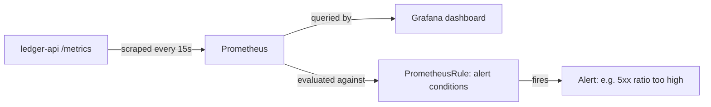
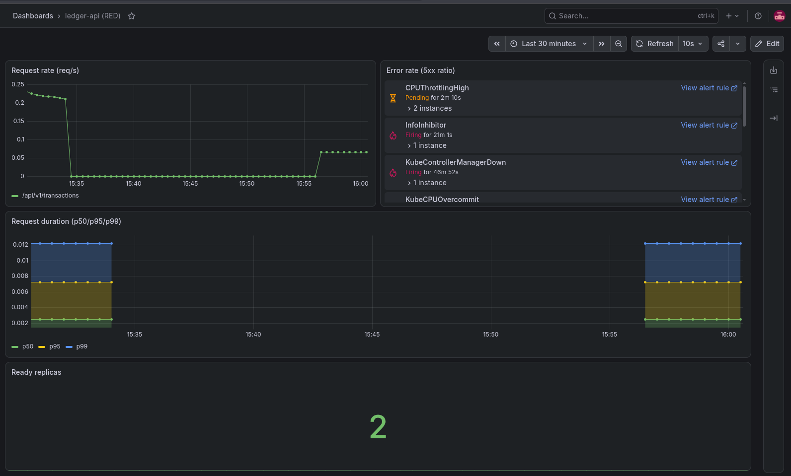

# 7. Observability: Metrics, Logs, Alerts

## Why "it's running" isn't enough

`kubectl get pods` showing `Running` tells you a process started and
hasn't crashed. It tells you nothing about whether requests are
succeeding, how slow they are, or whether something is quietly degrading
right now. **Observability** is the ability to answer "what is actually
happening inside this system?" without having to guess or SSH in and poke
around - usually broken down into three pillars: **metrics** (numbers over
time - request counts, latencies, error rates), **logs** (discrete
events, usually text, usually timestamped), and **traces** (the path a
single request took across multiple services - not used in this project,
since there's only one service, but worth knowing the term exists).

## Metrics: Prometheus and the pull model

**Prometheus** is the metrics system used here. Its defining design
choice is the **pull model**: instead of applications pushing their
metrics somewhere, Prometheus itself reaches out, on a schedule, and
*pulls* metrics from each target it's configured to watch, over plain
HTTP, from a `/metrics` endpoint the application exposes.

The app's own `/metrics` endpoint (added using the standard
`prometheus/client_golang` library) exposes, among other things:

```
http_requests_total{route="/api/v1/transactions",code="200"} 14
http_request_duration_seconds_bucket{route="/api/v1/transactions",le="0.05"} 14
```

A **counter** (`http_requests_total`) that only ever goes up, labeled by
route and status code, and a **histogram**
(`http_request_duration_seconds`) that buckets how long requests took,
letting you later compute percentiles (p50, p95, p99 - "50% of requests
were faster than X", "95% were faster than Y") without having had to
decide those exact percentiles up front.

### Telling Prometheus what to scrape: ServiceMonitor

Rather than hand-editing Prometheus's own configuration file every time a
new app needs scraping, this project uses the **Prometheus Operator**
(installed as part of the `kube-prometheus-stack` Helm chart), which adds
a Kubernetes custom resource called `ServiceMonitor`:

```yaml
apiVersion: monitoring.coreos.com/v1
kind: ServiceMonitor
metadata:
  name: ledger-api
  namespace: ledger
  labels:
    release: kube-prometheus-stack
spec:
  selector:
    matchLabels:
      app: ledger-api
  endpoints:
    - port: http
      path: /metrics
      interval: 15s
```

Create this object, and the Prometheus Operator automatically updates
Prometheus's scrape configuration to include it - no manual edits, no
restart.

## A real bug, and the lesson underneath it: Service *selector* vs Service *labels*

This is worth its own section, because the bug was subtle and the fix was
one line - and the underlying concept trips people up regularly.

A Kubernetes **Service** has two completely separate things that both
happen to be called similar names:

- `spec.selector` - which **Pods** this Service routes traffic to. "Send
  traffic to any Pod labeled `app: ledger-api`."
- `metadata.labels` - labels **on the Service object itself** - entirely
  separate from `spec.selector`, used by anything that wants to find
  *this Service*, not the Pods behind it.

The `ServiceMonitor`'s own `selector` (in the YAML above) matches against
the **Service's `metadata.labels`** - not its `spec.selector`, and not
the Pod's labels directly. The original Service manifest in this project
had a correct `spec.selector.app: ledger-api` (routing worked fine, pods
received traffic normally) but **no `metadata.labels` on the Service
itself at all**. Prometheus's `ServiceMonitor` never matched it - not
because anything was broken in the traditional sense, but because two
different-but-similarly-named fields were being confused for one another.

The practical symptom was genuinely confusing: the target didn't show up
as "down" in Prometheus - it simply never showed up *at all*, in the
normal "active targets" list. Finding it required checking Prometheus's
own `droppedTargets` list (visible through its HTTP API) and reading the
exact relabeling rule that was silently filtering it out. The fix was
one line:

```yaml
apiVersion: v1
kind: Service
metadata:
  name: ledger-api
  namespace: ledger
  labels:
    app: ledger-api        # <-- this line, separate from spec.selector below
spec:
  selector:
    app: ledger-api
  ports:
    - name: http
      port: 80
```

## Grafana and the RED method

**Grafana** is the dashboard layer on top of Prometheus - it queries
Prometheus (and other data sources) and renders the results as graphs,
gauges, and tables. This project's dashboard is built around the **RED
method**, a simple, widely-used framework for monitoring any request-
driven service:

- **R**ate - how many requests per second.
- **E**rrors - what fraction of those are failing.
- **D**uration - how long requests take (usually as percentiles, not just
  an average, since an average hides the worst experiences).



Proof this is wired up end to end and showing *real* data, not a static
mock: real `curl` traffic was generated against the app, and the
dashboard updated live.



## Alerts: a PrometheusRule

A metric sitting in a dashboard that nobody is looking at right now is
not the same as being alerted to a problem. A `PrometheusRule` defines a
condition that, when true for a sustained period, fires an alert:

```yaml
apiVersion: monitoring.coreos.com/v1
kind: PrometheusRule
metadata:
  name: ledger-api-rules
  namespace: ledger
  labels:
    release: kube-prometheus-stack
spec:
  groups:
    - name: ledger-api
      rules:
        - alert: LedgerApiHighErrorRate
          expr: |
            sum(rate(http_requests_total{code=~"5.."}[5m]))
            /
            sum(rate(http_requests_total[5m]))
            > 0.05
          for: 5m
          annotations:
            summary: "ledger-api 5xx ratio above 5% for 5 minutes"

        - alert: LedgerApiNotEnoughReplicas
          expr: |
            kube_deployment_status_replicas_ready{namespace="ledger", deployment="ledger-api"} < 2
          for: 5m
```

The query language here is **PromQL** - Prometheus's own query language.
`rate(http_requests_total{code=~"5.."}[5m])` reads as "the per-second rate
of increase of the counter `http_requests_total`, filtered to status
codes matching the regex `5..` (any 5xx), averaged over the last 5
minutes." Dividing that by the same rate with no filter gives the 5xx
*ratio*, not just a raw count - meaningful regardless of overall traffic
volume.

## Logs: Container Insights and KQL

Metrics answer "how much" and "how fast." For "what exactly happened, in
words, at this specific moment," AKS's **Container Insights** add-on
(built on Azure Monitor / Log Analytics) collects every container's
stdout automatically, with no extra agent to configure per-app. Querying
those logs uses **KQL** (Kusto Query Language), Azure's own log query
language - conceptually similar to SQL, piped step by step:

```kusto
ContainerLogV2
| where ContainerName == "ledger-api"
| extend parsed = parse_json(LogMessage)
| where tostring(parsed.level) == "ERROR"
| project TimeGenerated, route = tostring(parsed.route), status = tostring(parsed.status)
| order by TimeGenerated desc
```

Read top to bottom: start from the raw log table, filter to this specific
container, parse each line's JSON (the app logs structured JSON, not
freeform text - deliberately, so queries like this are possible), keep
only `ERROR`-level entries, pick out the fields that matter, sort newest
first.

## What's next

Everything running can now be seen and alerted on. The last piece: a scan
is only a snapshot in time - what happens to that guarantee the week
after you ship? That's
[Vulnerability Management](08-vulnerability-management.md).
