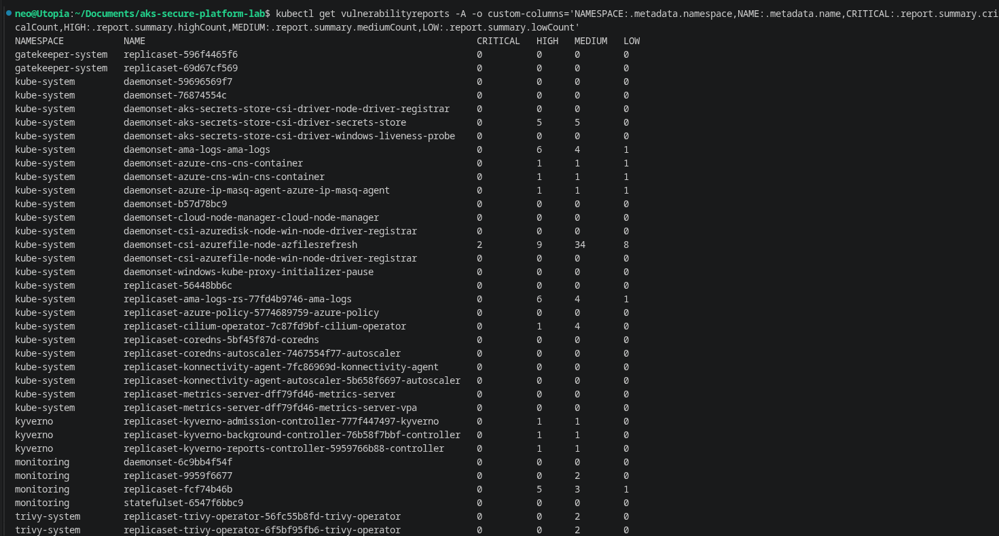

# 8. Vulnerability Management

## A clean scan today doesn't mean clean next week

[Chapter 1](01-containers-images.md) covered scanning an image at build
time with Trivy, and getting a clean result (zero HIGH/CRITICAL CVEs) for
the hardened build. It's tempting to treat that as a finished state - "we
scanned it, it's secure, done." It isn't, for one simple reason:
**vulnerabilities get discovered and published against software that
already exists and was already considered fine.** A library your app
depends on, or a package in your base image, can have a brand-new CVE
published against it next week, with no code of yours changing at all.
The image sitting in your registry, unchanged, becomes vulnerable the
moment that CVE is published - your last scan was correct *for that
moment*, not forever.

This means vulnerability management has to be a **loop**, not a one-time
gate: scan at build time (catch problems before they ship), then keep
re-checking what's already shipped and already running, for as long as
it's running.

## SBOM: knowing exactly what's inside, without re-scanning to find out

A **Software Bill of Materials (SBOM)** is a structured, machine-readable
list of every component inside a piece of software - every library,
every version, every dependency, direct or transitive. This project
generates one in **CycloneDX** format (one of the two dominant SBOM
standards, alongside SPDX) for every image built in CI, as a build
artifact.

The practical value shows up the moment a brand-new, high-profile CVE is
announced against some widely-used library (this happens regularly - a
popular logging library, a common compression library, a web framework).
Without an SBOM, answering "are we affected?" across every image you've
ever shipped means re-scanning everything, which takes time you may not
have if the CVE is being actively exploited. With an SBOM already
generated and stored for every build, the question becomes a quick
search: "does this exact library-and-version appear in any of our SBOMs?"
- seconds, not hours.

## The nightly rescan: CI keeps checking after the fact

A scheduled GitHub Actions workflow re-scans the image already sitting in
the registry (not rebuilding it - rescanning the exact bytes already
shipped) once a night, and automatically opens a GitHub issue if anything
new, fixable, and HIGH or CRITICAL shows up:

```yaml
on:
  schedule:
    - cron: "0 3 * * *"   # every night at 03:00 UTC

jobs:
  rescan:
    steps:
      - uses: aquasecurity/trivy-action@...
        with:
          image-ref: "ghcr.io/.../ledger-api:<sha>"
          severity: HIGH,CRITICAL
          ignore-unfixed: true   # don't report CVEs with no available fix - nothing actionable to do yet
          exit-code: "0"          # don't fail the workflow - we want a report, not a blocked pipeline at 3am
```

`ignore-unfixed: true` matters here specifically: a CVE with no fixed
version available yet isn't something you can act on today by bumping a
dependency - reporting it as if it were an open to-do just creates noise
that trains people to ignore the alerts. Filtering those out keeps every
alert that *does* fire meaningful.

## Continuous scanning inside the cluster itself

CI scanning only ever looks at the image sitting in a registry. It says
nothing about what's actually *running* right now, in production, which
might be an older image that was deployed weeks ago and simply never got
rebuilt since. **Trivy Operator** closes that gap by running inside the
cluster itself, continuously discovering every workload that's actually
deployed, and scanning it - producing live Kubernetes objects you can
query directly, the same way you'd query any other cluster resource:

```bash
kubectl get vulnerabilityreports -A
kubectl get configauditreports -n ledger
```

A `VulnerabilityReport` is exactly what it sounds like: CVE findings for
one specific running workload's image. A `ConfigAuditReport` is different
and complementary - it doesn't look at the image at all, it checks the
workload's *configuration* (does it run as root, does it have a
`NetworkPolicy`, does it declare resource limits) against known best
practices, independent of any CVE database.

Run against this cluster's real, actual workloads - not a demo, not a
curated example - this is what came back:



These aren't hypothetical numbers used to illustrate a concept - they're
real, currently-published CVEs found in components that were already
running in this exact cluster, discovered by a scanner that never stops
looking.

## A real, honest limitation: even a scanner needs permission to look

One concrete finding worth being explicit about: Trivy Operator's own
scan jobs (and, separately, Kyverno's image-signature check from
[chapter 6](06-admission-control.md)) were **not able to inspect the
`ledger-api` image itself**, specifically. Not because anything was
misconfigured in the usual sense, but because of a deliberate design
choice from [chapter 4](04-identity-and-secrets.md): the container
registry's admin account is disabled, by design, for least-privilege
access. The cluster's normal node identity has exactly one narrow
permission against that registry - **pull and run** images, which is all
a running pod actually needs. **Inspecting** image layers and signature
metadata directly, the way a scanner or a signature-verification tool
needs to, is a *different* operation, requiring its own, separate
registry credential that was simply never provisioned.

This is worth sitting with as a general lesson, not just a one-off bug:
"the cluster can run this image" and "this specific tool can read this
image's metadata" are two different permissions, and granting one
doesn't imply the other. The fix is known and specific (a read-only,
repository-scoped registry token, handed only to the tools that need it)
and is documented as an open item rather than silently worked around - a
scanner that's quietly failing to scan something is worse than one that's
honestly logged as not yet covering it.

## The triage process, once something real is found

Finding a vulnerability is only useful if there's an actual process after
it:

1. A scan (nightly, or build-time) finds a HIGH/CRITICAL, fixable CVE.
2. An issue is opened automatically (nightly scan) or the build is
   blocked outright (CI scan on a pull request).
3. Within a defined window (2 business days, in this project), check: is
   there a fixed version of the affected package or base image available?
   - If yes: bump it, open a pull request, let CI confirm the scan comes
     back clean, merge.
   - If no fix exists yet: document the exception explicitly (which CVE,
     why it's being accepted for now, when to re-check) rather than
     silently suppressing the finding and forgetting about it.
4. Redeploy. The next nightly scan confirms the finding is actually gone.

## Closing out the session

Eight chapters, one real project, every layer actually built and actually
tested: a hardened image with a measurable before-and-after, a cloud
foundation entirely as reviewable code, a secret that exists in exactly
one place and nowhere else, a network that trusts nothing by default, a
cluster that rejects bad workloads before they ever start, a dashboard
that shows real traffic, and a scanner that never stops checking what's
actually running.

The real, messy journey behind all of this - the exact errors hit, the
exact fixes applied, in order, with a screenshot for almost every step -
is in [The Build Log](../journal/the-build-log.md).
